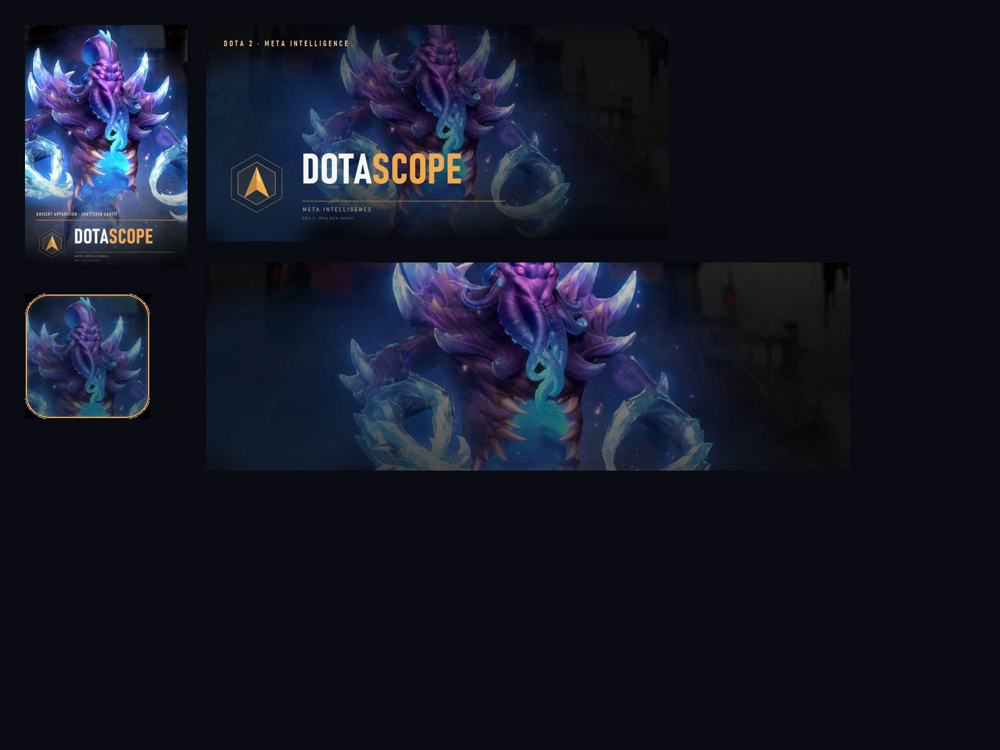

<p align="center">
  
</p>

<h1 align="center">DotaScope</h1>

<p align="center"><strong>Meta intelligence for Dota 2.</strong><br />
A dark, installable statistics cockpit for PC and Android, built on the OpenDota public API.</p>

DotaScope brings hero meta, matchups, professional play, player dossiers, match scoreboards, historical records and a read-only SQL lab into one responsive app. It ships as a native **Android APK**, a **standalone Windows EXE**, and a progressive web app (PWA) for any modern browser.

**[Download the latest build](https://github.com/theclintoris/DotaScope/releases/latest)** · **[Browse the source](https://github.com/theclintoris/DotaScope)** · **[Update log](CHANGELOG.md)**

## What is included

- **Meta lens** — switch between ranked pubs, pro and turbo populations, and ranked brackets 1–7. The choice is shared across every page and remembered locally.
- **Overview** — sample size, meta leader, win-rate extremes, pick pressure, trend chart, bracket/attribute distribution and the latest pro results.
- **Hero index** — search and filter by attribute, role, attack type and Captain's Mode eligibility; sort by win rate, pick share, picks, trend, meta score or pro presence; export CSV.
- **Hero dossier** — matchups, duration profile, item phases, bracket spread, pro pick/ban presence, daily pick history and base stats.
- **Matches** — the latest pro and public feeds with league, team, mode, lobby, rank, duration and time filters. Direct match-ID lookup.
- **Match detail** — gold/XP advantage chart, both scoreboards, items, KDA, GPM/XPM, last hits/denies, damage and a pick/ban draft board.
- **Players** — global OpenDota player search, numeric account shortcut, and a searchable professional directory.
- **Player profile** — career W/L, rank, estimated MMR, recent form, hero pool, match log, lane mix and attribute comfort.
- **Player hero dossier** — click any hero in a player's pool or match log for hero-specific win rate, form, KDA, final-item telemetry, recent builds and the full paginated match archive on that hero.
- **Draft lab** — a 5v5 counter-pick board for both line-ups, with role-filtered suggestions, matchup edges, item-independent meta blends and an MMR bracket guardrail. The bracket control reweights suggestions by that rank's win/pick rates; OpenDota does not publish bracket-split head-to-head samples, which the screen states explicitly.
- **Squad performance** — a player's most frequent public teammates, with games together, duo win rate, last queued and average GPM, sortable by games or win rate. This uses OpenDota's public peer history, not Steam's private friends list.
- **Your profile** — pin your own dossier above the Players directory and keep a compact form/record strip on Overview. The Windows app picks up the active Steam account automatically; the web app offers Steam sign-in plus a manual profile fallback.
- **Pro scene** — team Elo-style power index, active-team filters, latest series results and a pro hero draft-presence board.
- **Records** — twelve historical record books across parsed public matches.
- **Data Lab** — a read-only OpenDota SQL editor with a table/schema browser, examples, CSV export and a hard 100-row cap.
- **PWA shell** — install prompt, service worker, offline shell, safe-area mobile navigation, command palette (`Ctrl/⌘ K`) and responsive layouts from 390 px upward.

## Update log

Every shipped change is recorded in **[CHANGELOG.md](CHANGELOG.md)**, including
the native packaging, Steam integration and stability fixes. Add new work under
an `Unreleased` heading so the development path stays visible on GitHub.

## Run locally

Requirements: **Node.js 22+** (tested on Node 26) and npm.

```bash
npm install
npm run dev
```

Open the URL printed by Vite (normally `http://localhost:5173`).

To exercise the production bundle and service worker:

```bash
npm run build
npm run preview
```

Then open `http://localhost:4173`.

### Windows notes

This checkout's Vite config is loaded with `--configLoader native`; that flag is already baked into the npm scripts. It avoids a Windows `spawn EPERM` failure while Vite resolves real paths. If your npm cache lives outside a restricted workspace, point it back into the project:

```powershell
$env:npm_config_cache="$PWD\.npm-cache"; npm run build
```

## Install it on PC and Android

### Native releases

The native builds are bundled in this project:

| File | What it is |
| --- | --- |
| `DotaScope-1.0.0.apk` | Signed release APK for Android 7.0+ (minSdk 24, targetSdk 36) |
| `DotaScope-1.0.0-win-x64.exe` | Portable Windows x64 app (about 64 MB). No installer or environment setup. |
| `DotaScope-1.0.0.zip` | Static web build for the PWA / browser fallback. |

**Windows:** run `DotaScope-1.0.0-win-x64.exe`. Windows SmartScreen may warn because the build is not Authenticode-signed; choose **More info → Run anyway**. The app needs the **Microsoft Edge WebView2 Runtime** (already present on current Windows 10/11 systems) and .NET Framework 4.8 (included with Windows 10/11). There is no installer and no Electron runtime.

The EXE is a portable launcher with the full WebView2 app embedded inside. It chooses a writable data directory (`%LOCALAPPDATA%\DotaScope`, then `%APPDATA%\DotaScope`, then a `data` folder beside the EXE), sets its own extraction paths, and starts the host. You do **not** need to set `DOTNET_BUNDLE_EXTRACT_BASE_DIR` manually. Launching from the installed Steam shortcut uses the same launcher and picks up the active Steam account.

**Android:** enable installing unknown apps for your browser/file manager, open the APK, and confirm the install. It is signed with the project's local release key (CN=DotaScope); this key is not included in the repository. The APK has been signature- and manifest-verified, but was not run on a physical device or emulator in this environment.

Both native wrappers load the same bundled web build and use the public OpenDota API directly. Player search and player profiles were verified in the Windows app against account `295731192`; hero data, matches and every filter use the same packaged frontend. The service worker is disabled in both wrappers so assets always come from the bundled build.

### PWA

A PWA must be served over **HTTPS** or from **localhost**.

#### Windows / PC

1. Build and serve the app (`npm run build`, then `npm run preview`), or open your HTTPS deployment.
2. In Chrome or Edge, use the install icon in the address bar → **Install DotaScope**.
3. It opens in its own standalone window and appears in the Start menu.

The interface also runs normally in Zen and other current browsers. One-click installation on Windows currently depends on the browser's PWA support; if an install control is not exposed, keep using it as a normal tab.

#### Android

1. Deploy the contents of `dist/` to any HTTPS static host.
2. Open the URL in Chrome on Android.
3. Menu → **Install app** (or **Add to Home screen**).
4. Launch from the home screen; it runs full-screen with the mobile bottom navigation.

For LAN testing from a phone, `npm run preview -- --host 0.0.0.0` works, but HTTP origins other than localhost are not installable as PWAs.

## Steam sign-in and your pinned profile

Your selected profile is stored only on the device (`localStorage`). It appears first under **Players** and as a compact strip on **Overview**.

- **Windows app:** the WebView2 host reads the active Steam account from the local Steam client's `config/loginusers.vdf` and passes its public SteamID to the app. Launching DotaScope from Steam therefore pins your Dota dossier automatically. No password is read or requested.
- **Web / PWA:** **Sign in with Steam** opens Steam's OpenID page. After Steam redirects back, DotaScope uses the returned public SteamID to find the matching OpenDota account. Because the app is fully static and has no backend, this is a public profile link, not a verified secure session. Manual Steam-profile, SteamID64 or Dota account-ID entry is also available.
- **Android:** there is no local Steam client to read, so use manual profile entry. The APK has no account password or private Steam data access.

The app never asks for a Steam password, Steam Guard code, API key, or private inventory data. OpenDota profiles must be public.

## Steam library artwork

`steam-art/` contains a complete custom Steam library kit for the Windows app: a 600×900 library portrait, a 920×430 header, a clean 1920×620 hero, a transparent logo, a 256×256 icon, and a multi-size `.ico`. The icon and artwork use Ancient Apparition's **Shattered Sanity** Immortal set from Dota 2's Trove of Terror.



On Windows, after building `DotaScope-1.0.0-win-x64.exe`, install the shortcut and artwork with:

```bash
python scripts/install-steam-shortcut.py
```

The script finds the active Steam account, backs up `shortcuts.vdf`, adds or updates the non-Steam DotaScope entry, copies the grid assets, and restarts Steam. Steam must be closed while the file is written; the script handles that and creates a timestamped backup. See [steam-art/SOURCE.md](steam-art/SOURCE.md) for artwork attribution.

## Build the native apps

Android packaging needs **JDK 21** and **Android SDK 36**. On this machine the local toolchain lives in `.toolchain/` (gitignored); source it before Gradle commands:

```bash
source .toolchain/env.sh
npm run android:apk
```

`npm run android:apk` builds the web bundle, syncs it into `android/`, and runs Gradle `assembleRelease`. A release signing config is read from `android/keystore.properties` (gitignored). The signed APK is written to `android/app/build/outputs/apk/release/app-release.apk`.

For Windows, install **.NET SDK 8 or newer** and run:

```powershell
npm run windows:build
```

The script builds the web bundle, packs `dist/` into `windows/web.zip`, restores the WebView2 NuGet package using `windows/NuGet.config`, publishes the self-contained WebView2 host to `windows/DotaScope-app.exe`, then wraps it in a small .NET Framework portable launcher and writes `DotaScope-1.0.0-win-x64.exe` to the project root. The host serves the embedded `web.zip` through a virtual `https://dotascope.local` origin and renders it with WebView2. It does not use Electron. The launcher is built with the .NET Framework 4.8 `csc.exe` included with Windows; no Visual Studio install is required.

The Windows binary is unsigned. For public distribution, add an Authenticode code-signing certificate and sign the generated EXE. The Android release key in `android/` is for local sideloading/updates: keep it safe and reuse it for future versions, or replace it with your own production key before publishing.

### Static deployment

`dist/` is a static site. Netlify, Vercel, Cloudflare Pages, GitHub Pages or any HTTPS static host work. The app uses hash routing (`/#/heroes`), so no server-side rewrite rules are required. Deploy at a domain root; if you deploy under a subpath, set Vite's `base` option and rebuild. Service-worker registration is production-only.

## Data source and honest limits

DotaScope uses the [OpenDota API](https://docs.opendota.com/). The app has no backend and no DotaScope account or password system; requests go from your client directly to OpenDota, and the optional pinned profile is stored only on the device. Responses are cached in memory and `localStorage`, with stale-cache fallback when the network is unavailable.

Dotabuff does not publish a general public API. **This is not a pixel-for-pixel or data-complete clone of Dotabuff.** OpenDota exposes a large, but different and sometimes smaller, slice of Dota data. In particular:

- **Rate limits** — OpenDota's free tier is roughly 60 requests/minute per IP, with a daily cap. A first uncached visit fires several requests. When the API returns `429`, DotaScope shows a retry state; browse after a minute or use the cached data already stored locally.
- **Hero brackets** — `/heroStats` publishes bracket aggregates 1–7. There is no useful Immortal (bracket 8) sample, so the UI omits it. OpenDota's overall bracket win rates can sit at exactly 50% because of how the feed is normalized; per-hero rates still vary.
- **Pro data** — the pro feed is the latest ~100 matches, not a complete circuit archive. Some fields Dotabuff shows (notably game mode for pro matches) are absent, so DotaScope does not invent them.
- **Records** — only parsed public matches. Unparsed and private games are excluded.
- **Friends / squad** — Steam does not expose a player's private friend list to a client-only OpenDota app. DotaScope shows OpenDota's public `peers` history instead (the people you queue with most) and labels it honestly.
- **Public feed** — the latest 100 matches; direct match-ID lookup is available for older games.
- **Parsing** — some matches are unparsed, so items, drafts and economy charts can be incomplete. Item/ability constants come from OpenDota/Valve.
- **Explorer** — the Data Lab is read-only, limited to the tables OpenDota exposes, and truncates/append `LIMIT 100` where needed. Heavy queries can time out.
- **Image assets** — hero, item and team art is loaded from Valve/Steam CDNs through OpenDota URLs.

DotaScope is an unofficial fan project. It is not affiliated with Valve, Dotabuff or OpenDota. Dota 2 and related assets are trademarks of Valve Corporation.

## Project map

```text
src/
  components/   app shell, profile panels/dialog, command palette, meta lens, UI primitives
  context/      global population + bracket state, local profile store
  lib/          OpenDota client, cache, formatters, meta calculations, Steam helpers, PWA registration
  pages/        Overview, Heroes, HeroDetail, Matches, MatchDetail,
                Players, PlayerDetail, Pro, Records, DataLab, NotFound
public/
  icons/        PWA + favicon assets
  manifest.webmanifest
  sw.js         offline shell and runtime cache
windows/
  DotaScope.csproj      WinForms + WebView2 host
  Program.cs            embedded web server, data extraction, window lifecycle
  Launcher.cs           portable launcher that embeds and starts the host
  icon.ico
android/        Capacitor 8 Android project (Gradle, signing config)
assets/         Android adaptive icon + splash source art
scripts/
  build-windows.ps1     package dist + publish the Windows host + launcher
  build-launcher.ps1    embed the host in the portable EXE
  make-icons.py         regenerate the brand/PWA icons
  make-android-assets.py regenerate adaptive launcher + splash art
  qa-native.mjs         Playwright/CDP native-app smoke test
  visual-test.mjs       browser QA against system Chrome
  class-audit.cjs       audit class usage while editing CSS
```

Player pages and the general flow were smoke-tested with OpenDota account [`295731192`](https://www.dotabuff.com/players/295731192). The account is useful as a manual test fixture; it is not bundled or hard-coded into the app.

## Commands

| Command | Purpose |
| --- | --- |
| `npm run dev` | Vite development server |
| `npm run build` | Type-check and build the production app |
| `npm run preview` | Serve the built app locally |
| `npm run lint` | Run Oxlint on `src` |
| `npm run windows:build` | Build the Windows host and portable launcher EXE |
| `npm run android:apk` | Build and sign the release APK |
| `npm run android:sync` | Rebuild web assets and sync them into Android |
| `npm run android:open` | Open the Android project in Android Studio |
